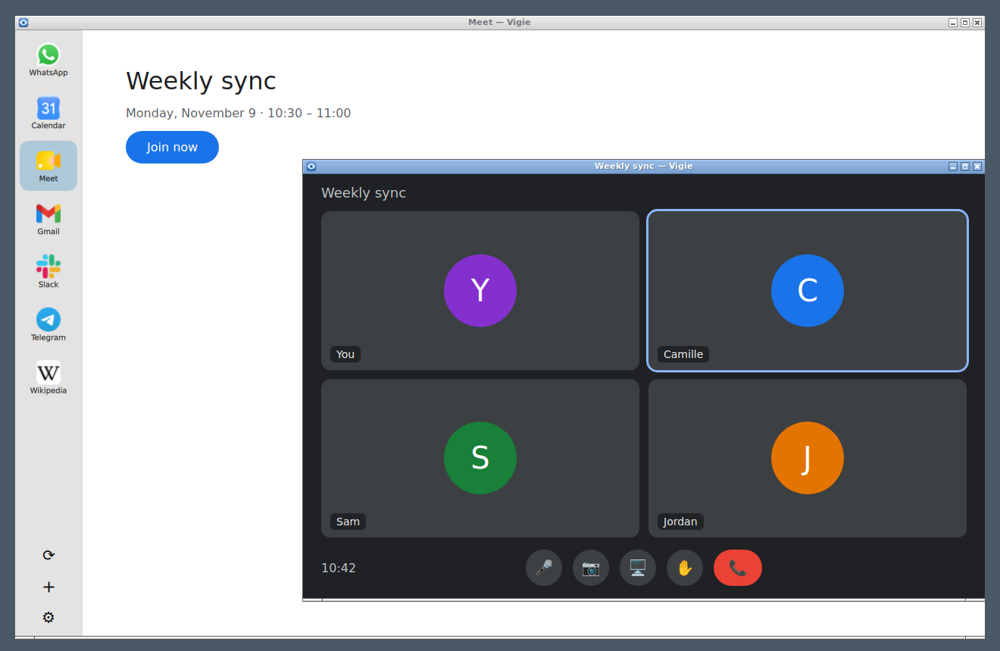
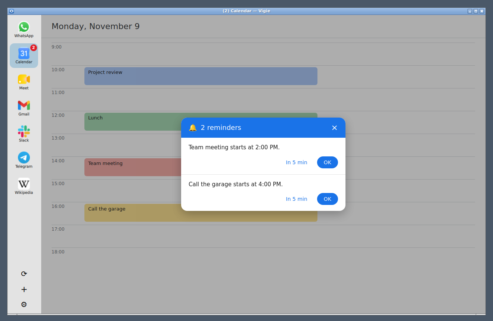

<p align="center">
  
</p>

<h1 align="center">Vigie</h1>

<p align="center">All your messaging apps in one window.</p>

WhatsApp, Gmail, Google Calendar, Meet, Slack, Telegram, Discord… and 440 other services, side by side in one light app, each with its unread count, its notifications and its own sign-in. Calls work, camera and microphone included. Vigie is a native Linux app, written in Rust and Qt, inspired by [Ferdium](https://github.com/ferdium/ferdium-app).

<p align="center">
  
  <br><em>A video call in its own Vigie window, over Meet, WhatsApp, Calendar, Gmail, Slack, Telegram and a custom website.</em>
</p>

<p align="center">
  
  <br><em>Calendar reminders, each with "In 5 min" and "OK"; the badge counts them.</em>
</p>

## What it does

- **No account, no limit**: everything stays on your computer (settings, sign-ins, cache). Vigie needs no account and no server of its own, unlike Franz or Rambox, and you can add as many services as you like.
- **Unread counts**: a red badge on each service's icon, the total in the window title and the tray icon.
- **Notifications** on the desktop, with the service's name and logo. A click opens the conversation. Mute them per service, or all at once with Do not disturb.
- **Calls**: audio and video (WhatsApp, Meet…), in their own Vigie window when the service opens one. Vigie asks before a service uses the microphone or the camera.
- **Video decoded by the graphics card**, H.265 included, when Vigie is built from the sources: security cameras (UniFi Protect with Enhanced Encoding) play as in a browser.
- **Security keys** (USB): a window asks you to plug the key in and touch it, then for its PIN if needed.
- **Google Calendar reminders** shown in Vigie, with "In 5 min" to be reminded again.
- **Separate sign-ins**: each service has its own, or several share one (Gmail, Calendar and Meet with a single Google sign-in).
- **Dark mode** for the services that have one.
- **Lock** with a password, at startup, on demand, or after some time away.
- **Hibernation**: services you rarely look at can be unloaded to save memory.
- **Never in the way**: pages that lost the network (on waking up, Wi-Fi connecting) reload by themselves once it's back, and, built from the sources, Vigie never prevents your computer from sleeping.
- **Updates** found and installed by Vigie itself.

The interface is in French or English (Settings → General).

## Installing

Vigie runs on Linux. It uses the system's Qt 6.10 or later (Ubuntu 26.04):

```bash
sudo apt install libqt6webenginequick6 qml6-module-qtwebengine qml6-module-qtwebchannel \
  qml6-module-qtquick-controls qml6-module-qtquick-layouts qml6-module-qtquick-dialogs \
  qml6-module-qtquick-effects qml6-module-qt-labs-platform
```

### From a release

Download `vigie-rs-X.Y.Z-linux-x86_64.tar.gz` from the [releases](https://github.com/yocarbo/vigie-rs/releases), and extract it into your home folder:

```bash
tar xzf vigie-rs-X.Y.Z-linux-x86_64.tar.gz --strip-components=1 -C ~/.local   # then run ~/.local/bin/vigie-rs
```

Installed this way, Vigie updates itself. Release archives use the system's Qt WebEngine: H.265 videos don't play (see below).

### From the sources

With Docker and git:

```bash
git clone https://github.com/yocarbo/vigie-rs.git && cd vigie-rs
docker build -t vigie-rs-dev .   # once: the build environment
./vigie-rs install               # builds Vigie and installs it in /usr (asks for your password)
```

Vigie is then in the applications menu. Built this way, it brings its own Qt WebEngine, with video decoding by the graphics card (H.265 included): the first build of it takes several hours, held back so that the computer stays usable, and is redone when Ubuntu updates its own. `./vigie-rs uninstall` removes Vigie; your settings and sign-ins stay.

## Getting started

Click **+** at the bottom of the sidebar, search the catalogue (WhatsApp, Gmail, Slack…), or choose "Custom website" for any address. Sign in to the service as in a browser.

- **Sidebar**: click an icon to show its service. Hold an icon and drop it onto another to reorder them.
- **Right-click on an icon**: mute its notifications or sound, open it in its own window, reload it, enable or disable it, edit it.
- **Right-click in a page**: spelling suggestions, copy, translate the selection, open a link in your browser, and Inspect (the developer tools).
- **Shortcuts**: Ctrl+R or F5 reloads the current service, Ctrl+W closes the window.
- **Tray icon**: grey at rest, red with unread messages. Its menu shows or hides the window, turns Do not disturb on or off, locks Vigie, or quits.

Vigie opens again on the service you were looking at. Closing the window can keep Vigie running in the background (Settings → General).

### Editing a service

Click its icon in Settings → Services, or right-click it → Edit:
- notifications, sound, and whether its unread messages count in the total;
- **Shared session**: give several services the same name (for example `google` for Gmail, Calendar and Meet) and they share one sign-in;
- **Navigation bar**: the page's address, back, forward and home, above the service;
- **New windows**: automatic (sign-in and call windows open in Vigie, other links in your browser), always in your browser, or always in Vigie;
- dark mode, user agent, hibernation, reload shortcut.

### Settings

- **General**: launch at login, start minimised, keep running in the background, language, hibernation, reload after waking up, backup (export and import of your services and settings, without sign-ins).
- **Version**: the current version, check for a new one, and the option to check for and install updates automatically.
- **Notifications**: Do not disturb, hide the content of notifications, copy two-factor codes from notifications.
- **Appearance**: theme, icon size, names under icons, navigation bar.
- **Privacy**: password lock.
- **Advanced**: downloads folder, user agent, GPU acceleration, spell checking (French, English), translator.

## Updates

Once a week, Vigie checks whether a new version is out, and installs it by itself; **Restart** then starts the new one. You can also check by hand in Settings → Version, or turn the automatic updates off there.

Built from the sources, Vigie fetches the new version, builds it and installs it in a window that shows each step. You can keep using Vigie meanwhile, or close the window: the update carries on. If Vigie is installed in a system folder, the system asks for your password once.

## Tips

- **Google says "This browser or app may not be secure"**: Vigie already presents itself to Google in the way it accepts. After many attempts in a row, Google refuses for a while: wait, then try again. If it keeps refusing, give the service a new session name to start afresh.
- **Gmail, Calendar and Meet** with one Google sign-in: give them the same session name.
- **Theme**: after changing Vigie's theme, restart it for the pages to follow. Slack has its own dark theme (Preferences → Themes in Slack).
- **No tray icon on GNOME**: install the AppIndicator extension. Notifications work without it.
- **Security keys**: USB keys only; passkeys on a phone or in a password manager don't work in Vigie: cancel, and the site offers another way to sign in.
- **Where your data is**: settings in `~/.config/vigie-rs/settings.json`, sign-ins in `~/.local/share/vigie-rs/`. Disk encryption protects them while the computer is off.
- **What Vigie asks the Internet**, besides your services: GitHub once a week for updates, and Google's public list of Chrome versions once a week, so that sites see an up-to-date browser. Both can be turned off.

## For developers

Building, the code, recipes, tests and releases: see [DEVELOPMENT.md](DEVELOPMENT.md).

## Acknowledgements

Many thanks to the [Ferdium](https://github.com/ferdium) project and its contributors:
- Vigie's features and behaviour are inspired by [Ferdium](https://github.com/ferdium/ferdium-app) (Apache-2.0); Vigie is a separate program, written from scratch in Rust and Qt.
- The `recipes/` catalogue comes from [ferdium-recipes](https://github.com/ferdium/ferdium-recipes), © Ferdium Contributors, under the MIT licence. The recipes were adapted for Vigie: their `Ferdium` API object was renamed `Vigie`, and one recipe under an unclear licence (`buffer`) was left out.

Ferdium itself continues the work of [Ferdi](https://github.com/getferdi/ferdi) and [Franz](https://github.com/meetfranz/franz), whose authors wrote many of these recipes.

## Licences

Vigie's own code is released under the MIT licence, see `LICENSE`.

The `recipes/` catalogue is distributed under the MIT licence, © Ferdium Contributors, from [ferdium-recipes](https://github.com/ferdium/ferdium-recipes). Its copyright notice, in `recipes/LICENSE.md`, and the `LICENSE` files inside individual recipes must stay with the files. Exception: `recipes/weekplan` is under Apache-2.0 (see its `LICENSE`).

Vigie's Qt WebEngine (`qtwebengine/`), rebuilt from Ubuntu's `qt6-webengine` source package with two build options and two lines of Chromium changed, keeps its licences (LGPL-3 and others, Chromium's included), listed in `qtwebengine/copyright`.

The spell-checker dictionaries, converted from the hunspell packages of Ubuntu and shipped in the release archives, keep their own licences (French: MPL-2.0; English: SCOWL and WordNet notices), copied next to them in `dictionaries/*.copyright`.
